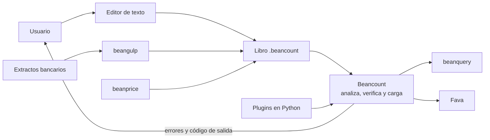

# 01. Visión general

## Problema que resuelve

Quien lleva sus cuentas en una hoja de cálculo o una aplicación cerrada tiene pocas garantías de que los datos cuadren y depende de un formato ajeno. Beancount propone guardar la contabilidad en un archivo de texto con estas propiedades:

- **Partida doble verificable.** Los importes de cada transacción deben sumar cero, dentro de una tolerancia. Se comprueba en [`beancount/ops/validation.py:350`](../beancount-src/v3.2.3/beancount/ops/validation.py#L350).
- **Aserciones de saldo.** `balance` afirma cuánto debe haber en una cuenta en una fecha; si no coincide, es un error ([`beancount/ops/balance.py:164`](../beancount-src/v3.2.3/beancount/ops/balance.py#L164)).
- **Control de cuentas.** Usar una cuenta sin abrir o ya cerrada es un error ([`beancount/ops/validation.py:194`](../beancount-src/v3.2.3/beancount/ops/validation.py#L194)).
- **Inversiones por lotes.** Registra posiciones a su costo y las empareja al venderlas ([`beancount/parser/booking_full.py:564`](../beancount-src/v3.2.3/beancount/parser/booking_full.py#L564)).
- **Datos propios y duraderos.** Al ser texto, el libro se edita con cualquier editor y se versiona con Git.

## Público objetivo

No hay una declaración formal de público en el código. Por lo que exige el producto (escribir en un lenguaje formal, usar la terminal, conocer las cuentas contables), se orienta a personas cómodas con herramientas técnicas que gestionan finanzas personales o de pequeña escala. Es una inferencia mía, no una afirmación del proyecto.

## Flujo típico de un usuario

1. Crea un archivo `.beancount` y abre sus cuentas con `open`.
2. Registra transacciones a mano o con un importador externo.
3. Ordena el archivo con `bean-format` ([`beancount/scripts/format.py:176`](../beancount-src/v3.2.3/beancount/scripts/format.py#L176)).
4. Lo valida con `bean-check` ([`beancount/scripts/check.py:36`](../beancount-src/v3.2.3/beancount/scripts/check.py#L36)) y corrige los errores.
5. Añade `balance` a partir de sus extractos bancarios.
6. Consulta los datos con `bean-query` o Fava, que son productos aparte.

Para probar sin datos propios, `bean-example` genera un libro ficticio ([`beancount/scripts/example.py:1851`](../beancount-src/v3.2.3/beancount/scripts/example.py#L1851)).

## Ecosistema

Solo se mencionan; no se analizan aquí.

| Proyecto | Función | Evidencia |
|---|---|---|
| beancount | Este repositorio: lenguaje, carga, validación y cinco comandos | [`pyproject.toml:54`](../beancount-src/v3.2.3/pyproject.toml#L54) |
| beanquery | Lenguaje de consulta y `bean-query` | [`CHANGES:34`](../beancount-src/v3.2.3/CHANGES#L34); versión 0.2.0 instalada en `.venv-323` |
| beangulp | Importación desde extractos | [`CHANGES:33`](../beancount-src/v3.2.3/CHANGES#L33) |
| beanprice | Obtención de precios | [`CHANGES:35`](../beancount-src/v3.2.3/CHANGES#L35) |
| beangrow | Cálculo de rendimientos | [`CHANGES:36`](../beancount-src/v3.2.3/CHANGES#L36) |
| Fava | Interfaz web | [`CHANGES:205`](../beancount-src/v3.2.3/CHANGES#L205) lo recomienda en lugar de `bean-web` |

`beanquery` **no** es una dependencia declarada de beancount: las únicas son `click`, `python-dateutil` y `regex` ([`pyproject.toml:30`](../beancount-src/v3.2.3/pyproject.toml#L30)).

## Diagrama de contexto

Las flechas hacia y desde los proyectos externos reflejan su función general; este repositorio no contiene su código, así que esas relaciones no están verificadas aquí.
