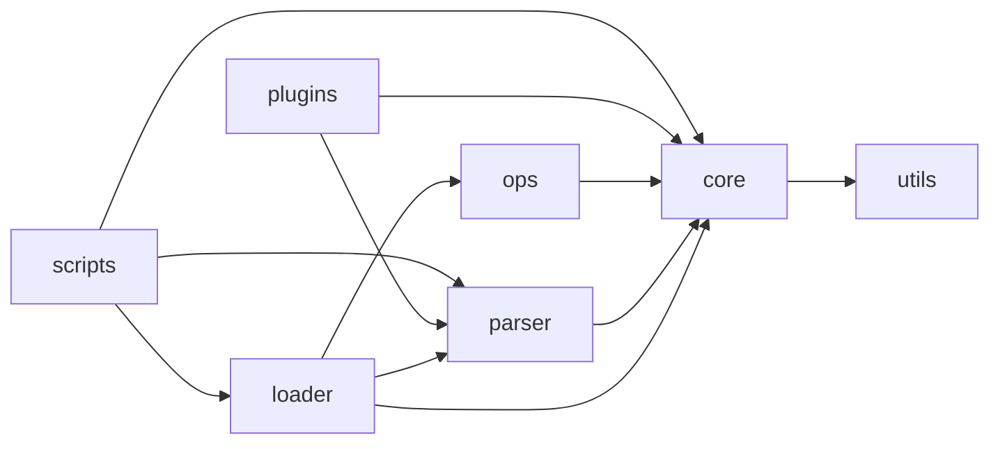

# 02. Arquitectura

Beancount es, en esencia, una **tubería de datos**: entra texto y sale una terna `(entries, errors, options_map)`. La función `_load` ([`beancount/loader.py:563`](../beancount-src/v3.2.3/beancount/loader.py#L563)) muestra toda la arquitectura en unas 40 líneas, y es el mejor punto para empezar a leer el código.

Diagrama: [diagramas/arquitectura.mmd](diagramas/arquitectura.mmd).

## Las capas

Se ejecutan en este orden ([`beancount/loader.py:598-627`](../beancount-src/v3.2.3/beancount/loader.py#L598)):

| # | Capa | Qué hace | Implementación | Comp. |
|---|---|---|---|---|
| 1 | Análisis léxico | Convierte bytes en tokens | [`beancount/parser/lexer.l`](../beancount-src/v3.2.3/beancount/parser/lexer.l) | C1 |
| 2 | Análisis sintáctico | Aplica la gramática y llama al Builder | [`beancount/parser/grammar.y`](../beancount-src/v3.2.3/beancount/parser/grammar.y), [`beancount/parser/parser.c`](../beancount-src/v3.2.3/beancount/parser/parser.c) | C1 |
| 3 | Construcción | Crea las directivas y acumula errores | [`beancount/parser/grammar.py:145`](../beancount-src/v3.2.3/beancount/parser/grammar.py#L145) | C1 |
| 4 | Carga | Resuelve `include`, combina y ordena | [`beancount/loader.py:376`](../beancount-src/v3.2.3/beancount/loader.py#L376) | C1 |
| 5 | Booking | Empareja lotes y completa importes | [`beancount/parser/booking.py:26`](../beancount-src/v3.2.3/beancount/parser/booking.py#L26), [`beancount/parser/booking_full.py:130`](../beancount-src/v3.2.3/beancount/parser/booking_full.py#L130) | C2 |
| 6 | Transformación | Ejecuta plugins en secuencia | [`beancount/loader.py:639`](../beancount-src/v3.2.3/beancount/loader.py#L639) | C1 y C2 |
| 7 | Validación | Comprueba invariantes finales | [`beancount/ops/validation.py:410`](../beancount-src/v3.2.3/beancount/ops/validation.py#L410) | C2 |
| 8 | Presentación | Formatea errores y fija el código de salida | [`beancount/parser/printer.py:556`](../beancount-src/v3.2.3/beancount/parser/printer.py#L556), [`beancount/scripts/check.py:92`](../beancount-src/v3.2.3/beancount/scripts/check.py#L92) | C3 |

## Decisiones de diseño visibles en el código

**Los errores son datos, no excepciones.** Cada etapa añade objetos de error a una lista y la carga continúa ([`beancount/loader.py:607`](../beancount-src/v3.2.3/beancount/loader.py#L607), [`beancount/loader.py:627`](../beancount-src/v3.2.3/beancount/loader.py#L627)). Un error se define por protocolo: `source`, `message` y `entry` ([`beancount/core/data.py:35`](../beancount-src/v3.2.3/beancount/core/data.py#L35)). Esto permite informar de muchos errores en una pasada, aunque la lista final mezcla todos los tipos.

**Las directivas son inmutables.** Son `NamedTuple` ([`beancount/core/data.py:93`](../beancount-src/v3.2.3/beancount/core/data.py#L93)). Para cambiarlas se crea una copia con `_replace`, como hace [`beancount/parser/booking_full.py:240`](../beancount-src/v3.2.3/beancount/parser/booking_full.py#L240).

**Los plugins usan el mismo contrato que el propio sistema.** `pad` y `balance` son plugins internos ([`beancount/loader.py:65`](../beancount-src/v3.2.3/beancount/loader.py#L65)), con la firma `f(entries, options_map)` que devuelve `(entries, errors)`.

**Los importes usan `Decimal`.** El tipo base se importa en [`beancount/core/number.py`](../beancount-src/v3.2.3/beancount/core/number.py), y las posiciones sin número usan el centinela `MISSING` ([`beancount/core/number.py:31`](../beancount-src/v3.2.3/beancount/core/number.py#L31)) durante el análisis.

**El analizador C se comprueba contra sus fuentes.** Al importar `parser.py` se verifica un hash de los archivos fuente ([`beancount/parser/parser.py:141`](../beancount-src/v3.2.3/beancount/parser/parser.py#L141), [`beancount/parser/hashsrc.py:52`](../beancount-src/v3.2.3/beancount/parser/hashsrc.py#L52)).

**Caché de carga.** Si cargar tarda 1 s o más, el resultado se guarda en `.{archivo}.picklecache` ([`beancount/loader.py:75`](../beancount-src/v3.2.3/beancount/loader.py#L75), [`beancount/loader.py:79`](../beancount-src/v3.2.3/beancount/loader.py#L79)). Se invalida con un hash MD5 de nombre, fecha y tamaño de los archivos ([`beancount/loader.py:323`](../beancount-src/v3.2.3/beancount/loader.py#L323)), no de su contenido. Se desactiva con `BEANCOUNT_DISABLE_LOAD_CACHE` ([`beancount/loader.py:847`](../beancount-src/v3.2.3/beancount/loader.py#L847)).

## Dirección de las dependencias

`core` es la base: los demás paquetes dependen de él y solo depende de `utils`. Datos de [dependencias_paquetes.csv](inventario/dependencias_paquetes.csv), sin contar pruebas; diagrama en [diagramas/dependencias_modulos.mmd](diagramas/dependencias_modulos.mmd).

Hay dependencias que rompen la jerarquía estricta: `parser` y `ops` importan `beancount` raíz en algunos módulos (`parser -> raiz`: 2; `ops -> raiz`: 1). Por ejemplo, [`beancount/parser/version.py`](../beancount-src/v3.2.3/beancount/parser/version.py) usa `beancount.__version__`. Además, el booking está en `parser` aunque conceptualmente pertenece al núcleo.

## Puntos de entrada

Declarados en [`pyproject.toml:54`](../beancount-src/v3.2.3/pyproject.toml#L54) y extraídos a [entry_points.csv](inventario/entry_points.csv):

| Comando | Destino |
|---|---|
| `bean-check` | [`beancount/scripts/check.py:36`](../beancount-src/v3.2.3/beancount/scripts/check.py#L36) |
| `bean-doctor` | [`beancount/scripts/doctor.py:92`](../beancount-src/v3.2.3/beancount/scripts/doctor.py#L92) y sus subcomandos |
| `bean-example` | [`beancount/scripts/example.py:1851`](../beancount-src/v3.2.3/beancount/scripts/example.py#L1851) |
| `bean-format` | [`beancount/scripts/format.py:176`](../beancount-src/v3.2.3/beancount/scripts/format.py#L176) |
| `treeify` | [`beancount/tools/treeify.py:409`](../beancount-src/v3.2.3/beancount/tools/treeify.py#L409) |

En `bean-doctor`, el `main` declarado es un alias del grupo `doctor` ([`beancount/scripts/doctor.py:551`](../beancount-src/v3.2.3/beancount/scripts/doctor.py#L551)).

Como biblioteca, los puntos de entrada son `loader.load_file` ([`beancount/loader.py:89`](../beancount-src/v3.2.3/beancount/loader.py#L89)), `loader.load_string` ([`beancount/loader.py:341`](../beancount-src/v3.2.3/beancount/loader.py#L341)) y la API pública ([`beancount/api.py:1`](../beancount-src/v3.2.3/beancount/api.py#L1)), reexportada desde el paquete raíz ([`beancount/__init__.py`](../beancount-src/v3.2.3/beancount/__init__.py)).

## Compilación

[`pyproject.toml`](../beancount-src/v3.2.3/pyproject.toml) usa `mesonpy` y [`meson.build`](../beancount-src/v3.2.3/meson.build) genera el analizador: Flex procesa `lexer.l` ([`meson.build:215`](../beancount-src/v3.2.3/meson.build#L215)), Bison procesa `grammar.y` ([`meson.build:226`](../beancount-src/v3.2.3/meson.build#L226)), y ambos se enlazan con `decimal.c`, `parser.c` y `tokens.c` en la extensión `_parser` ([`meson.build:237`](../beancount-src/v3.2.3/meson.build#L237)). Bison se ejecuta con `-Wall -Werror`, así que las advertencias de gramática impiden compilar.
